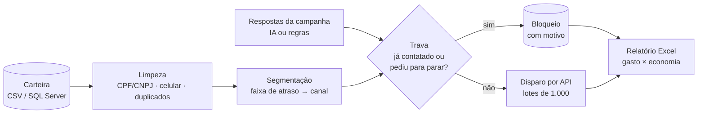

# Automação de cobrança · pipeline em Python

[](https://github.com/Kauan1005/automacao-cobranca/actions/workflows/ci.yml)


No trabalho, eu automatizei a geração diária das campanhas de cobrança de uma carteira: 5 fluxos em
**KNIME** (~1.700 nós) que pegam a carteira no **SQL Server**, limpam e segmentam os contatos, disparam
WhatsApp e RCS por **API REST** e, antes do envio, passam por uma **trava em T-SQL** que impede contato
repetido. Um relatório em **Python** mede todo dia quanto foi gasto e quanto foi economizado.

Este repositório reproduz a **mesma lógica em Python puro**, com **dados 100% fictícios**, para mostrar
o raciocínio em código e com testes. Nenhum dado, nome, regra comercial ou arquivo da empresa está aqui.

> Na operação real, a trava economizou **cerca de R$ 22,5 mil em 11 dias de envio** (≈ R$ 2 mil por dia).
> Os valores deste repositório são fictícios.

## Como funciona



| Etapa | Arquivo | O que faz |
|---|---|---|
| Limpeza | [`cobranca/limpeza.py`](cobranca/limpeza.py) | valida CPF/CNPJ pelos dígitos verificadores, recoloca zeros perdidos pelo Excel, escolhe o primeiro celular válido e mantém um contrato por pessoa |
| Segmentação | [`cobranca/segmentacao.py`](cobranca/segmentacao.py) | separa por faixa de atraso (aviso, 05–30, 31–120, 121–990), escolhe o canal e ordena por valor em aberto |
| Trava | [`sql/trava_envio.sql`](sql/trava_envio.sql) · [`cobranca/trava.py`](cobranca/trava.py) | tira da fila quem já recebeu no mesmo canal dentro do intervalo mínimo e registra o motivo (T-SQL no trabalho, SQLite aqui para rodar sem servidor) |
| Respostas (IA) | [`cobranca/respostas.py`](cobranca/respostas.py) | classifica as respostas dos clientes (já pagou, número errado, pediu para parar, quer negociar, pediu boleto) com o **Claude** e saída em JSON validada por esquema; sem credencial, usa regras de palavras-chave. Quem pediu para parar sai da próxima campanha; quem quer negociar vai para um atendente |
| Disparo | [`cobranca/disparo.py`](cobranca/disparo.py) | monta o JSON da campanha e envia em lotes; por padrão roda simulado e só grava os arquivos |
| Relatório | [`cobranca/relatorio.py`](cobranca/relatorio.py) | planilha com enviados, bloqueados, gasto, economia e % por canal e faixa, mais os motivos de descarte |

Como cada nó do KNIME virou código: [docs/knime-para-python.md](docs/knime-para-python.md).

## Rodar

```bash
pip install -r requirements.txt
python dados/gerar_exemplo.py          # gera a carteira e o histórico fictícios
python -m cobranca.pipeline            # roda tudo e grava saida/relatorio_AAAA-MM-DD.xlsx
python -m unittest discover -s tests   # 18 testes, sem chamar nenhuma API
```

Saída com os dados de exemplo:

```
contatos válidos: 460  descartes: {'documento inválido': 34, 'sem celular válido': 114, 'duplicado': 22}
bloqueados (trava + respostas): 67  lotes enviados (simulado): 4
respostas classificadas por: regras  encaminhados ao atendimento: 22
gasto: R$ 78.06  economia: R$ 17.76  (19% do custo)
relatório: saida/relatorio_2026-10-26.xlsx
```

### Classificar as respostas com IA

```bash
pip install -e ".[ia]"                 # instala o SDK da Anthropic
export ANTHROPIC_API_KEY=...           # ou: ant auth login
python -m cobranca.pipeline --ia
```

O modelo recebe as respostas em lotes de 50 e devolve um JSON validado por esquema (só as 6 intenções
permitidas). O que ele não devolver, ou um lote recusado, cai para as regras: nenhuma resposta fica sem
classificação. Os testes usam um cliente falso, então a CI nunca chama a API.

Para um envio real, defina `COBRANCA_API_URL` (https) e `COBRANCA_API_TOKEN` e chame
`executar(..., dry_run=False)`. A API usada aqui é genérica e fictícia.

## Decisões

- **A trava fica no banco, não no fluxo.** Quem decide se um contato pode receber é a consulta que roda
  na hora do envio, então dois fluxos rodando no mesmo dia não mandam mensagem duplicada.
- **Todo descarte tem motivo.** O relatório mostra por que cada contato saiu (documento inválido, sem
  celular, duplicado, já contatado). É isso que permite calcular a economia.
- **Simulado por padrão.** Rodar o projeto nunca dispara mensagem de verdade.
- **IA onde ela ajuda, com plano B.** Entender "já paguei, mas foi pelo app" é difícil para regra fixa e fácil
  para um modelo de linguagem. Mesmo assim, o pipeline funciona sem a IA, e as duas formas devolvem o mesmo formato.
- **Só biblioteca padrão + openpyxl.** O SDK da Anthropic é opcional. Fácil de rodar em qualquer máquina e no CI.

## Estrutura

```
cobranca/      código do pipeline
sql/           trava e estrutura das tabelas em T-SQL
dados/         gerador de dados fictícios (semente fixa)
tests/         testes de unidade e um teste ponta a ponta
docs/          mapeamento dos nós KNIME para as funções Python
```

---

Kauan Ribeiro Almeida · [portfólio](https://kauanportfolio.netlify.app) · [LinkedIn](https://www.linkedin.com/in/kauan-ribeiro)
